# local-robot: a robot factory in simulation, on one Mac

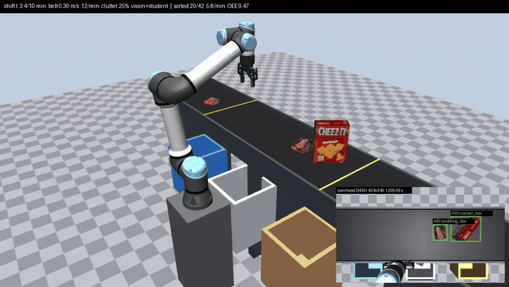

<sub>The F5 shift, 12 s at real speed from a recorded 10-minute run: belt at 0.3 m/s, 12 items a minute, a quarter of them arriving as touching pairs. The robot knows where things are only through the overhead depth camera (inset); the top strip is the live KPI counter. Rendered from MuJoCo.</sub>

A simulated recycling-sorting cell, built the way a robotics team would build a real one: a Universal Robots UR5e with a
Robotiq gripper and a suction cup, a conveyor belt, an overhead RealSense-style depth camera, and 11 scanned household
objects (the YCB benchmark set) that must be sorted into plastic, metal and cardboard chutes while the belt keeps moving.
It goes discipline by discipline: inverse kinematics and grasp planning, intercepts on a moving belt with Kalman
tracking, a carry learned by reinforcement learning, perception from depth pixels alone, a 10-minute production shift
with OEE accounting, a hobby desk arm with every imperfection of real hardware modelled and calibrated away, and the
fast belt where the first design sorted nothing. Before the factory, two quadrupeds learned to walk on the same
machine: a Unitree Go1 on the CPU (MuJoCo's new batch API, PPO, about two minutes) and a Unitree Go2 on the Apple GPU
(Genesis on Metal, 4,096 robots in parallel, about a minute and a half). Everything runs locally on one MacBook Pro
(Apple M5 Max). Every measured result below (tables, charts, acceptance numbers) comes from a result file in this
repository, failures included; the "what went wrong" notes also quote development observations from the build log, which
is not published, and say so.

> [!WARNING]
> **🚧 Work in progress.** Phases **F0 to F7 are done**: each passed an acceptance test that was written down before
> its evaluation ran (protocols in `factory/*/results/*-protocol*.md`). **Not built yet:** F8, a second arm on the same
> belt; F9, a grasp learned at speed with a coding agent designing the reward; F10, a 30-minute shift with everything
> on, bit-exact replay and a scorecard of all fifteen disciplines. See [What's next](#whats-next). Simulation only: no
> physical robot has run this code.

## Contents

- [At a glance](#at-a-glance) · [The whole mechanism](#the-whole-mechanism) · [How success was measured](#how-success-was-measured)
- Chapters: [0 · Two walking robots](#chapter-0--two-walking-robots-two-engines) · [F0 · The cell](#f0--the-cell-exists) · [F1 · Classical pick](#f1--a-classical-pick-from-a-stopped-belt) · [F2 · Moving belt](#f2--the-belt-never-stops) · [F3 · Learned carry](#f3--a-carry-learned-by-reinforcement-learning) · [F4 · Seeing](#f4--seeing-camera-only) · [F5 · The shift](#f5--the-factory-a-10-minute-shift) · [F6 · Desk arm](#f6--a-hobby-desk-arm-with-a-real-device-kit) · [F7 · Fast belt](#f7--the-fast-belt-and-the-operating-envelope)
- [All results](#all-results) · [What's next](#whats-next) · [Tech stack](#tech-stack) · [Hardware](#hardware-and-requirements) · [Running it](#running-it) · [Layout](#repository-layout) · [Credits and licences](#credits-and-licences)

## At a glance

| stage | the question | the answer (from the result files) |
|---|---|---|
| Go1, CPU | Can a laptop CPU train a walking quadruped quickly? | 1,024 robots x 600 PPO iterations in **112 s**; trotting at a commanded 1 m/s from iteration 225, 31 s in |
| Go2, Metal GPU | Does GPU-parallel simulation work on Apple Silicon? | Genesis on Metal: **455k env-steps/s** at 4,096 envs; a walking Go2 in **93.5 s** including kernel compilation |
| F0 | Do scanned objects ride a simulated belt stably, in two engines? | **132/132** rides pass in MuJoCo and in Genesis (CPU backend) |
| F1 | Can a classical pipeline (no learning) pick every item from a stopped belt? | **198/200** (99.0%, Wilson 95% 96.4-99.7%) |
| F2 | What does a moving belt cost? | 7.8 sorted/min at 0.15 m/s, 6.5 at 0.3 m/s; up to half the items go by unsorted (capacity, not accuracy) |
| F3 | Can learning beat the classical carry on objects it never saw? | yes, in all 4 line conditions on 40 fresh seeds; but a hand-written prior gets most of the gain |
| F4 | How much does seeing only through a camera cost? | **2.5 and 4.4 points** of sort rate (bar: under 10) |
| F5 | What does a 10-minute shift look like on a dashboard? | 58 of 140 sorted, **OEE 41%**, 0 wrong chutes, 0 protective stops |
| F6 | Does it survive hobby servos, backlash, latency, noise and a mis-mounted camera? | classical 200/200, behaviour-cloned ONNX policy **189/200**, calibration ≤ 1.46 mm, system ID within 3.2% |
| F7 | What happens at 0.5 m/s? | the first design sorted **0.00**/min; three changes, useless alone, together give **4.00**/min |

## The whole mechanism

The sorting cell as it runs in F5 to F7. Every box is a module in `factory/`. From F4 on the pipeline gets item
positions and names only from the camera, never from the simulator (for the carry policy a test enforces it).

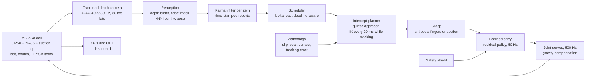

## How success was measured

The same rules held from F0 to F7, and they are why the numbers can be trusted:

- **Acceptance tests fixed first.** Each phase has a pass/fail test in [`docs/sorting-cell-spec.md`](docs/sorting-cell-spec.md).
  From F3 on, each acceptance run has a protocol committed before it ran: fresh seeds never used in development, the
  comparison, the margin, and a sample size sized from a pilot's spread (`factory/*/results/*-protocol*.md`).
- **Paired comparisons on the same seeds.** Two cells are run on identical item streams and the per-seed difference is
  reported with a 95% confidence interval; success rates get Wilson intervals. "Beyond the noise floor" means the
  interval excludes zero.
- **Held-out objects.** The learned carry trained on 8 items and was judged on 3 it never saw (the Windex bottle, the
  sugar box, the tuna can: one per material, one on the suction cup).
- **Planted ground truth, not human judgement.** Calibration is tested against a camera error planted at a known value;
  system identification against plant parameters planted 20-50% off; perception against the simulator's true poses.
  Nobody rates videos by eye to decide a result.
- **Every attempt is reported.** F3 took three attempts, F6 three; the failed ones are below with their numbers.
- **The video is part of the test.** Two F3 bugs that no metric showed were found by watching rendered runs.
- **Every bug becomes a regression test.** `factory/tests/` (pytest) holds the guards named in each chapter.
- **Development observations are labelled.** The "what went wrong" notes quote numbers seen during development (from
  the build log, which is not published); they explain the design, and none of them is an acceptance result.
- **The history here is a fresh export.** In the original development history each protocol was committed before its
  run; this repository starts from a clean export of the finished state, so that ordering cannot be checked here.

---

## Chapter 0 · Two walking robots, two engines

**The question.** What can this Mac actually train? Most robot-learning stacks assume an NVIDIA GPU. Here there is an
18-core CPU and a 40-core Apple GPU. Two routes were tried and both ended in a walking robot the same evening
(2026-11-01).

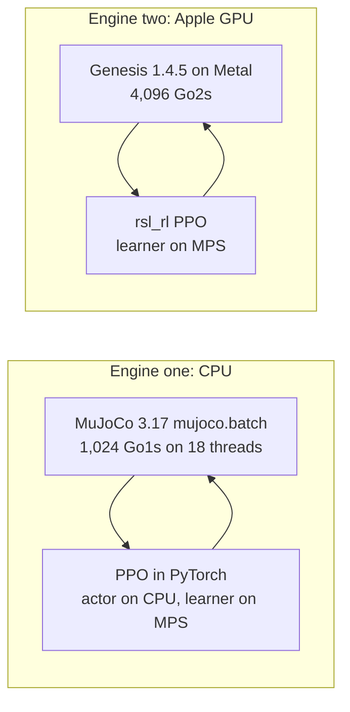

**Engine one: a Go1 on the CPU.** MuJoCo 3.17 (released 2026-10-22) added `mujoco.batch`, a first-party API that steps
many copies of one model on a thread pool with the Python GIL released. The trainer is the PPO joystick example of the
archived `mjbatch` project, ported to the new API (`lib/go1_batch317.py`; physics, rewards and PPO unchanged). Each
iteration runs 1,024 Go1s for 24 control steps; the policy sees 50 numbers (gyro, gravity direction, joint angles and
speeds, the command) and outputs 12 joint targets; ten named reward terms (velocity tracking, a trot gait clock, pose,
penalties for tipping, bouncing, wobble, joint limits, jerky actions and hard landings) are logged separately.

```python
# lib/go1_batch317.py: 1,024 simulations stepped as one batch, their state bound as NumPy views
self.batch = batch = Batch(model, num_envs, nthread=THREADS, persistent=True)
self.qpos, self.qvel, self.ctrl = (batch.bind(f) for f in ("qpos", "qvel", "ctrl"))
...
self.ctrl[:] = STAND + ACTION_SCALE * action          # every robot's 12 joint targets at once
self.batch.step(nstep=DECIMATION, stage=STAGE)        # 5 physics steps of 4 ms each, GIL released
...
ratio = (logp - logp_old[i]).exp()                    # the PPO clipped surrogate
surrogate = torch.min(ratio * adv[i], ratio.clamp(1 - CLIP, 1 + CLIP) * adv[i])
```

<p align="center">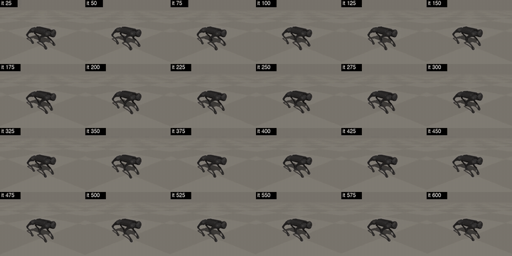</p>
<p align="center"><sub>The learning timeline: every 25th checkpoint of one run driven side by side with the same command. Iteration 25 shuffles in place; from about iteration 225 the policy trots at the commanded speed. Watch the last second: the two most-trained checkpoints (575 and 600, bottom right) collapse while standing still, which the fall counter did not record (see below). Rendered with mujoco.Renderer from the run's checkpoints.</sub></p>

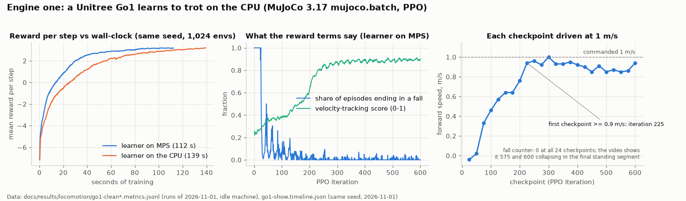
<sub>Data: `docs/results/locomotion/go1-clean*.metrics.jsonl` and `go1-show.timeline.json` (2026-11-01). Same seed and settings; only where the learner runs differs.</sub>

**Measured.** On an idle machine, 600 iterations (14.7 million environment steps) took **112.1 s with the learner on
the GPU (131k steps/s) and 139.2 s with it on the CPU (106k steps/s)**. The two learners end at different rewards
(3.1744 on MPS, 3.1988 on the CPU), but every rerun of the same configuration matched its own to four decimals: three
MPS-learner runs at 3.1744 and two CPU-learner runs, with 12 and 18 simulation threads, at 3.1988
(`go1-final-iterations.jsonl`). The first checkpoint that walks the
commanded 1 m/s within 10% is iteration 225, **31 s into the 112 s run**. The timeline's fall counter reads 0 for all
24 checkpoints, but the video shows iterations 575 and 600 collapsing flat in the final standing segment (from about
8.3 s), with the last one's body partly through the floor: the counter's fall test missed it, and the cause has not
been investigated. Evaluated on a scripted command sequence: 0 falls, speed error 0.11 m/s at 1 m/s, 0.29 at 1.5 m/s, and a
weak 0.37 m/s walking backwards at -0.6 m/s (`go1-clean.eval.json`). The very first run, with another job holding the
GPU, took 283.9 s for the same result.

**Engine two: a Go2 on the Apple GPU.** Genesis 1.4.5 runs its simulation on Metal. Its Go2 locomotion example with
rsl_rl (a copy in `lib/genesis_go2/`, patched only to record headless) trained 4,096 robots for 101 iterations in
**93.5 s including the first kernel compilation** (60 s between the first and last iteration). Every episode lasted
its full 1,001 steps from iteration 86 on (first reached at 73). Evaluated on the CPU backend: 0 falls and a 0.07 m/s speed error at
the 0.5 m/s it was trained on, 0.20 and 0.23 at speeds it never saw (0.3 and 0.8 m/s): it learned one speed.

<p align="center">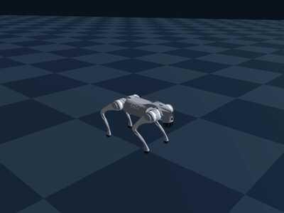</p>
<p align="center"><sub>The trained Go2 evaluated on Genesis's CPU backend (Genesis has no batch renderer on macOS, so evaluation renders run on the CPU).</sub></p>

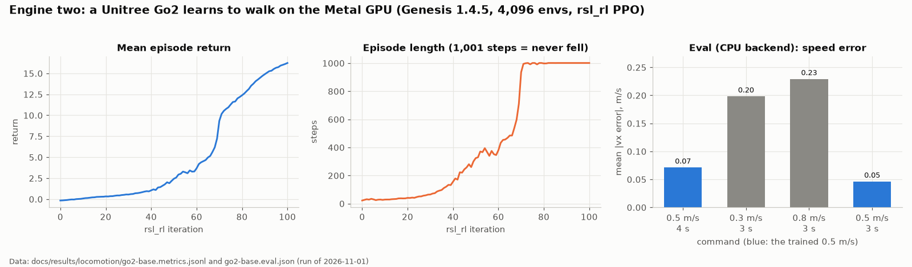
<sub>Data: `docs/results/locomotion/go2-base.metrics.jsonl`, `go2-base.eval.json` (2026-11-01).</sub>

**What the machine can do**, measured with `rl bench` (other jobs shared the machine for some of these, as noted in the log):

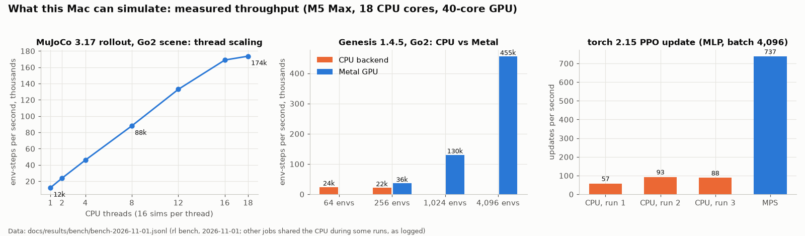
<sub>Data: `docs/results/bench/bench-2026-11-01.jsonl` (`rl bench mj|genesis|torch`, 2026-11-01).</sub>

MuJoCo scales 14x from 1 to 18 threads (12.1k to 174k env-steps/s on the Go2 scene). Genesis's CPU backend stays near
22-24k env-steps/s; on Metal it does 36k at 256 robots and 455k at 4,096: the GPU pays off in bulk (first kernel build 41 s).
A small MLP's PPO update is 8-13x faster on the GPU (MPS) than on 6 CPU threads.

**What went wrong** (development notes). Genesis's example called `scene.get_error_envs_mask()`, which genesis-world 1.4.5 lacks (guarded
in `lib/genesis_go2/go2_env.py`). Rendering inside the training loop cut throughput about four times, so the live view
became a separate process that hot-reloads the latest checkpoint onto its own small batch of robots (`rl watch`). A
`tee` in a pipeline hid a failed trainer's exit code (`bin/rl` now runs with `pipefail`). This Mac's ffmpeg has no
`drawtext` filter, so contact sheets are drawn in Python (`scripts/sheet.py`).

---

## F0 · The cell exists

**The question.** Can scanned real-world objects ride a simulated conveyor without tipping, sliding, sinking or
exploding, and does the layout put everything inside the arm's reach? Disciplines: cell layout, modelling and simulation.

<p align="center">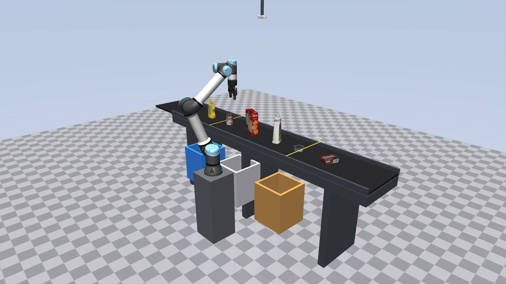</p>

**The mechanism.** Every dimension lives in one file (`factory/cell/layout.py`); `build_mjcf.py` assembles the UR5e,
the 2F-85 and the belt into one MJCF from the MuJoCo Menagerie models, and Genesis loads the same parts. The belt is a
treadmill: a plate on a slide joint driven by a stiff velocity servo, teleported back every 0.4 m so items ride it by
friction forever. The objects are the 11 YCB scans, each split into 2-12 convex pieces with CoACD (physics engines
collide convex shapes), given its real mass and an inertia from the pieces.

```python
# factory/cell/cell_mujoco.py: the treadmill. The plate slides at belt speed and jumps back, keeping its velocity,
# so items resting on it are carried by friction alone
mujoco.mj_step(m, d)
if d.qpos[self.belt_qpos] >= b.reset_travel: d.qpos[self.belt_qpos] -= b.reset_travel     # the treadmill: slide back, keep velocity
elif d.qpos[self.belt_qpos] <= -b.reset_travel: d.qpos[self.belt_qpos] += b.reset_travel
```

<p align="center">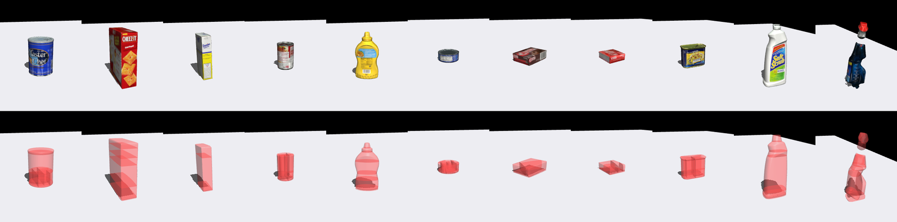</p>
<p align="center"><sub>The 11 YCB items as rendered (top) and as the physics engine sees them (bottom, convex pieces).</sub></p>

**Measured.** Each item x 4 orientations x 3 belt speeds rode through the zone in each engine. Pass = still on the belt,
tilt under 15°, slip under 2% of belt speed, sideways drift under 2 cm, penetration under 3 mm (criteria fixed before
the runs). **MuJoCo 132/132, Genesis 132/132** (Genesis on its CPU backend). The regression test `test_engines_agree`
also pushes a cracker box for 3 s in both engines and requires the two to end within 1 cm.

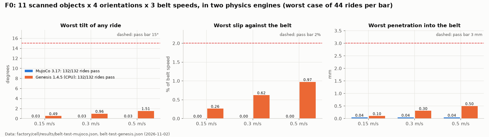
<sub>Data: `factory/cell/results/belt-test-mujoco.json`, `belt-test-genesis.json` (2026-11-02).</sub>

The reach map samples 400,000 joint configurations through forward kinematics (0.9 s) and solves exact top-down IK on
a 2 cm grid: the 1 m zone is 98% reachable with the gripper pointing down at a grasp 10 cm above the belt, 83% at 25 cm
(the far corners), each chute opening 100%. It also sets the time budget the rest of the project fights: an item spends
**6.7 s in the zone at 0.15 m/s, 3.3 s at 0.3, 2.0 s at 0.5**.

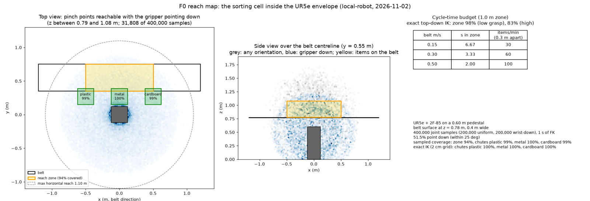
<sub>The project's own figure (`factory/cell/reach_map.py`, data `factory/cell/results/reach-map.json`, 2026-11-02).</sub>

**What went wrong** (development notes from the build log), each now a test in `factory/tests/test_f0_cell.py`:

<p align="center">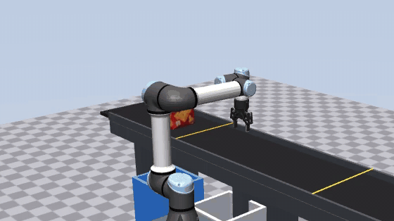</p>
<p align="center"><sub>The robot's park pose left the fingertips 14 cm above the belt; the 21 cm cracker box walked into them. The park pose is part of the layout now.</sub></p>

- Side rails touching the sliding plate held the belt at 5 mm/s (a 5 mm gap fixed it).
- YCB scan origins sit off the objects (the soup can's by 8 cm) and the Windex scan is tilted 8°: every item gets a
  canonical frame, its most upright stable resting pose computed from the convex hull with the real centre of mass.
- The Windex bottle toppled at every speed in both engines: the transparent bottle scanned badly and stood on a 14 cm²
  patch with its centre of mass 2.4 mm from the edge. Every item now gets a 3 mm pad shaped like its bottom outline.
- Items sank 1.4 mm on landing (MuJoCo's default 20 ms contact time constant on the plate); 4 ms gives 0.04 mm.
- A bottle dropped 0.34 m sank 10 mm into a 1 cm chute floor: thicker walls and floor.

---

## F1 · A classical pick from a stopped belt

**The question.** Before any learning: can inverse kinematics, a grasp library, a motion planner and joint control pick
any of the 11 items off a stopped belt into the right chute, 95% of the time over 200 trials? Disciplines: kinematics,
grasp planning, motion planning, control, software architecture.

<p align="center">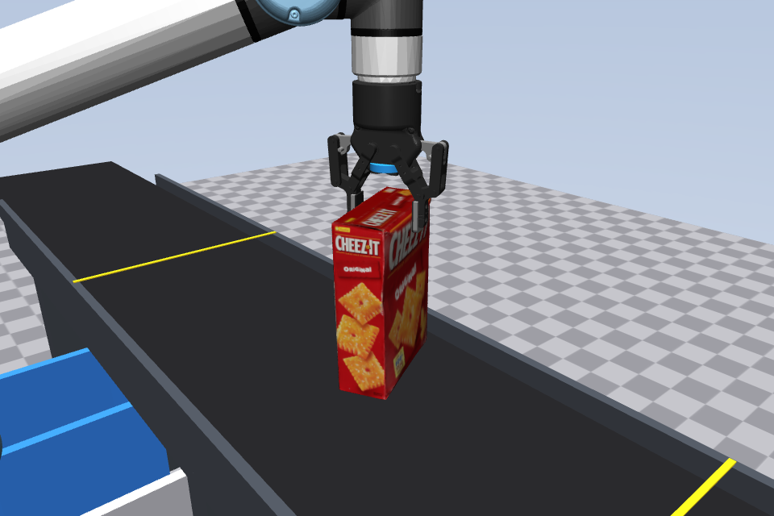 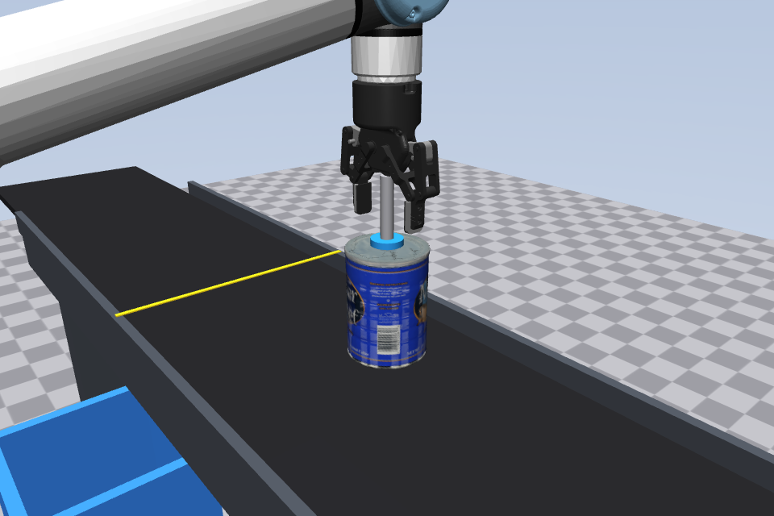</p>
<p align="center"><sub>The hybrid tool: an antipodal finger grasp on the cracker box, and the suction cup on the coffee can, which is wider than the 85 mm stroke.</sub></p>

**The mechanism.**
- **Kinematics** (`factory/classical/kinematics.py`): forward kinematics from MuJoCo's own model of the arm,
  damped-least-squares IK with joint limits and random restarts, the Jacobian, Yoshikawa's manipulability measure.
- **Grasp library** (`grasps.py`): for each scanned mesh, rays cast from both sides at every 10° of closing direction
  and three heights find pairs of contact points; a pair is kept if it fits the stroke and both surface normals lie
  inside the friction cone (an *antipodal* grasp). Seven items have finger grasps; four (the coffee can, the tuna can,
  the flat pudding and gelatin boxes) are wider than the stroke, so a suction cup on a slide was added on the
  gripper's axis, as on real bin-picking tools.
- **Planner** (`pick.py`): waypoints joined by straight Cartesian lines solved by IK every centimetre, timed as
  minimum-jerk motions under joint and tool speed and acceleration limits; a carried item limits the tool's
  acceleration by how far it hangs below the pads.
- **Executor**: the arm's position servos fed the reference plus velocity feed-forward and gravity compensation at
  500 Hz, watching for every failure class while it runs.

```python
# factory/classical/grasps.py: keep a finger grasp only if it fits the stroke and both contact normals lie inside the
# friction cone of the closing axis (mu = 0.5)
width = float(np.linalg.norm(p2 - p1))
if width > MAX_WIDTH or width < 0.01: continue
ang1 = math.acos(np.clip(np.dot(n1, -a), -1, 1)); ang2 = math.acos(np.clip(np.dot(n2, a), -1, 1))   # outward normals vs the push directions
if ang1 > cone or ang2 > cone: continue
```

```python
# factory/cell/cell_mujoco.py: the vacuum seals only when the cup meets a face squarely, and lets go above 60 N
if n is None or abs(float(c.frame[:3] @ axis)) < cos_max: continue
self._seal(n); return
...
if f > self.vac_cfg["max_force"]:   # the seal breaks: the item falls
```

**Measured.** 200 seeded trials (all 11 items, anywhere in x ±0.4 m, y ±0.08 m, any yaw), run on 6 CPU processes in
40 s: **198/200 = 99.0% (Wilson 95% 96.4-99.7%)**; a second seed 199/200. The two failures are tall bottles dropped on
a tilted grasp. A pick takes 7.3 s on average (p95 8.7 s); planning takes 8.5 ms. A sweep of 1,000 planned picks over a
wider zone had **0 robot collisions and 0 carried-item hits** (4 reported unreachable). The IK regression test
(`test_ik_1000_zone_poses`) requires at least 880 of 1,000 random zone poses within 1 mm and 1° (910 when it was
written) and checks that every pose it calls infeasible is also unreachable for the exact top-down solver. The
servos settle a 0.1 rad step in 0.77 s with no overshoot.

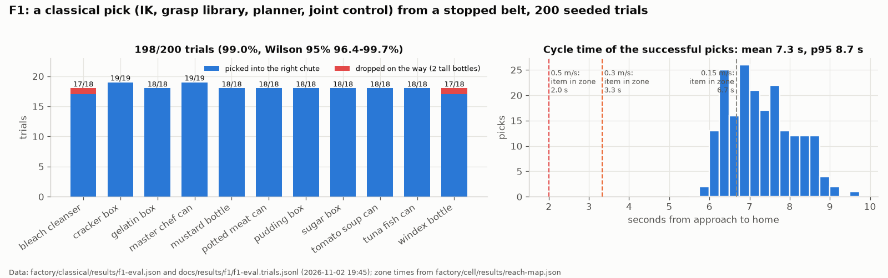
<sub>Data: `factory/classical/results/f1-eval.json`, `docs/results/f1/f1-eval.trials.jsonl` (2026-11-02). The dashed lines are why F2 exists: at 0.3 m/s an item is in reach for 3.3 s, and a careful pick takes 7.3.</sub>

**What went wrong** (development notes from the build log). The first full evaluation scored 186/200, below the
bar, and each failure class had one cause:
MuJoCo's adhesion actuator pulled with full force the instant it switched on and flipped the 97 g gelatin box (the
vacuum became a weld with a seal check); a 1.1 kg bleach bottle held by its neck swung out of the fingers on short
fast transfers (a load-dependent acceleration limit); tall bottles on the far side were out of reach pointing straight
down (approaches tilted 20° and 35° are tried too). A self-inflicted bug: the vacuum reset switched off *every* equality
constraint, including the ones that hold the 2F-85's linkage together. And the planning sweep found what 400 simulated
picks had missed: after a flat box, the move home swept the open fingers through the belt rail in 182 of 1,000 plans,
because the simulation checks contacts every 20 ms and slipped past. The arm now retreats straight up first
(`test_zero_collisions_over_1000_planned_picks`).

---

## F2 · The belt never stops

**The question.** With items arriving at random on a moving belt, what throughput does the classical pipeline reach,
and what does it miss? This is the baseline learning has to beat. Disciplines: state estimation and tracking,
scheduling, safety and reliability.

<p align="center">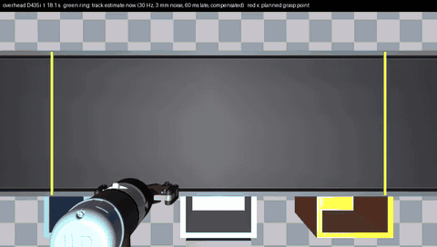</p>
<p align="center"><sub>What tracking sees: the simulated D435i's view with each Kalman track (green ring) and the planned grasp point (red cross), 30 Hz, 3 mm noise, 60 ms latency compensated.</sub></p>

**The mechanism.**
- **A simulated camera** reports each item's position 30 times a second, 60 ms late, with 3 mm noise and a 5% chance
  of a missed frame (`factory/line/tracking.py`). Identity is still given in F2; F4 takes it away.
- **A Kalman filter per item** on (x, y, vx, vy). Each report carries the time its frame was *taken*, so the filter
  predicts across the latency instead of treating late reports as fresh. Tracks start at the belt encoder's speed.
- **The intercept planner** (`line.py`) times a joint-space quintic approach to arrive above the item exactly when the
  item does, already moving at belt speed; then descends, closes and lifts while riding along with the belt (IK every
  20 ms on the predicted position), while the newest track estimate keeps correcting the reference until the pads touch.
- **Schedulers** (greedy, earliest deadline first, lookahead) and a failure taxonomy: every item ends as sorted,
  missed, late, wrong chute, dropped or knocked off; robot faults (slip, no seal, contact, a joint 0.15 rad behind its
  reference) trigger a protective stop and recovery.

```python
# factory/line/tracking.py: a constant-velocity Kalman update that uses the time a frame was taken
dt = rep["t"] - self.t
if dt < 0: return   # out of order: drop
F, Q = self._F(dt); x = F @ self.x; P = F @ self.P @ F.T + Q
H = np.array([[1, 0, 0, 0], [0, 1, 0, 0.]]); S = H @ P @ H.T + self.r * np.eye(2); K = P @ H.T @ np.linalg.inv(S)
self.x = x + K @ (rep["pos"][:2] - H @ x); self.P = (np.eye(4) - K @ H) @ P; self.t = rep["t"]
```

**Measured.** 180 s of line per configuration, 2 seeds, all 11 items arriving as a Poisson stream:

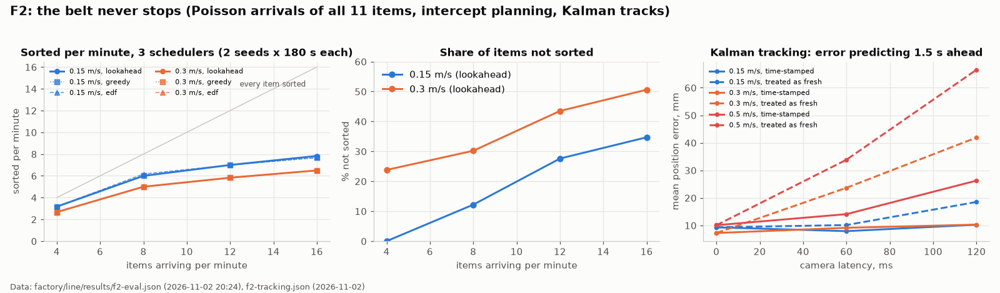
<sub>Data: `factory/line/results/f2-eval.json` (2026-11-02 20:24), `f2-tracking.json` (2026-11-02).</sub>

At 16 arrivals a minute the cell sorts **7.8/min at 0.15 m/s and 6.5/min at 0.3 m/s**, and 35% and 51% of items go by
unsorted. The misses are capacity, not skill: attempts succeed 92-100% of the time with a 2-3 mm grasp error, but a
cycle takes 5.3-5.8 s and an item is in reach for about 4 s. The three schedulers land within the seed noise of each
other, because when the robot comes free there is usually only one item it can still reach. Time-stamping the camera
reports is worth it: predicting 1.5 s ahead, the error stays at 7-10 mm at 0.15-0.3 m/s for any latency up to 120 ms,
against 24-42 mm at 0.3 m/s when late reports are treated as fresh.

<p align="center">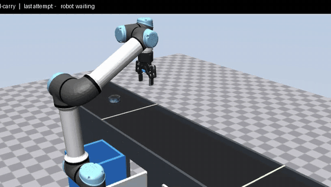</p>
<p align="center"><sub>A planted fault: the suction lets go of the tuna can mid-carry. The slip watchdog flags it, the robot recovers and re-picks the can, and it is sorted.</sub></p>

**What went wrong** (development notes). The first moving picks missed by 5-15 cm: young tracks started from a zero-velocity prior and aimed
behind the item (a real line knows its belt speed from the drive's encoder). An early intercept search kept pushing the
meeting time later and chased one item down the belt to x = 9 m. Even with good tracks the open-loop plan missed by
23 mm; correcting the reference with the newest estimate brought it to 2-4 mm. The contact check missed a planted dive
into the belt plate, which the joint-tracking watchdog caught, and that same watchdog tripped twice with no contact at
all on a fast approach to the heavy bleach bottle: a nuisance stop, the classic cost of a sensitive threshold
(`test_planted_faults_are_detected_and_recovered`).

---

## F3 · A carry learned by reinforcement learning

**The question.** Can a learned policy beat the classical pipeline on objects it never trained on, beyond the noise?
Of F2's 5.3-5.8 s cycle, **2.63 s on average goes on carrying the item to the chute, lowering it, letting go and coming
back** (F2's own carry, averaged over the 356 training grasps in `f3-train.json`), done cautiously because a bottle held by its
neck swings like a pendulum.
The grasp already works, so F3 learns the carry. Disciplines: learning, testing and evaluation.

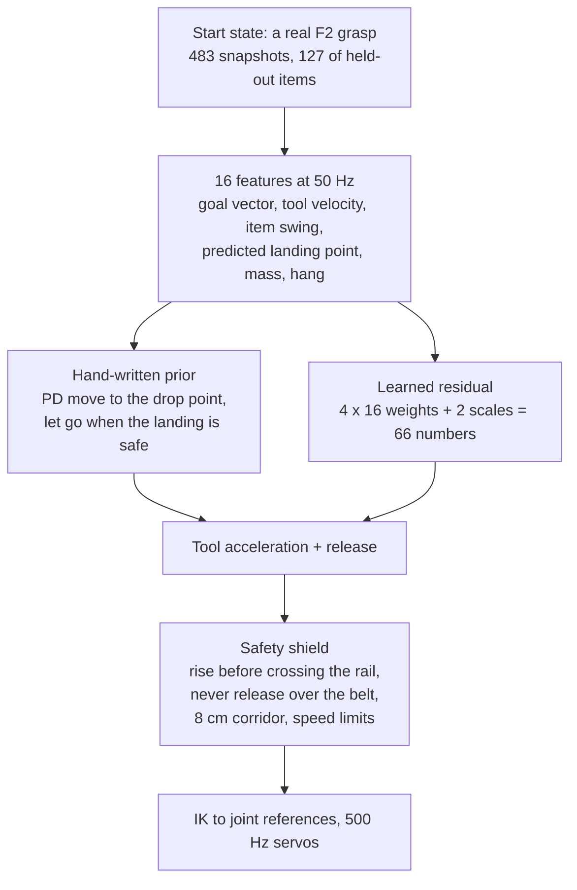

**The mechanism.** The policy is a *residual* on a hand-written prior: with all weights zero it moves the tool to the
drop point and lets go in flight once the predicted landing point is safely inside the chute. Learning adds a linear
correction and scales the gain and the acceleration limit: 66 numbers. Training uses **Augmented Random Search**: perturb the numbers in 16
random directions, run each direction both ways on the same 10 start states, and step along the 8 directions whose two
sides differed most. Return = 25 for a sorted item minus the seconds until the robot is free. Domain randomisation
(item mass x0.85-1.2, friction x0.7-1.1) and a curriculum (light items first) are on. No gradients, no neural network,
14 CPU processes, no GPU.

```python
# factory/learned/train_f3.py: one ARS step
deltas = rng.standard_normal((a.dirs, carry.NP))
...                                                     # run theta +/- noise * delta on the same start states
R = np.array([r["reward"] for r in rs]).reshape(a.dirs, 2, a.per_dir).mean(axis=2)
order = np.argsort(-R.max(axis=1))[:a.top]; sd = R[order].std() + 1e-6
theta = theta + a.step / (a.top * sd) * ((R[order, 0] - R[order, 1])[:, None] * deltas[order]).sum(axis=0)
```

<p align="center">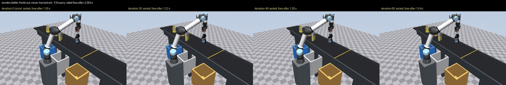</p>
<p align="center"><sub>The learning timeline: the same carries replayed with checkpoints 0, 20, 40 and 60 side by side. At checkpoint 0 (the prior) the tall cracker box is let go too high and lands across the chute rim.</sub></p>

**Measured.**

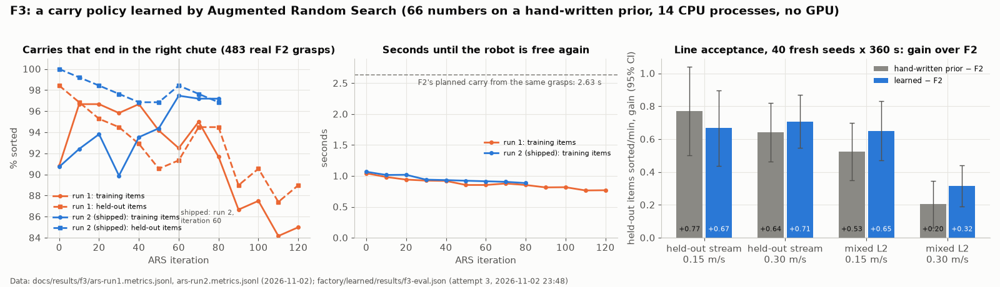
<sub>Data: `docs/results/f3/ars-run1.metrics.jsonl`, `ars-run2.metrics.jsonl` (2026-11-02); `factory/learned/results/f3-eval.json` (attempt 3, 40 fresh seeds x 360 s, 2026-11-02 23:48).</sub>

- On the 483 recorded grasps (run 2, iteration 60, chosen on training states only): training items sorted **97.5%**
  (prior 90.7%, F2's carry 96.1%), held-out **98.4%** (prior 100%, F2 97.6%); the robot is free after **0.91 s**
  instead of F2's 2.63 s. Run 2: 80 iterations, 25,600 episodes, 12 minutes on 14 processes.
- **On the line, attempt 3** (protocol fixed in advance: 40 fresh seeds x 360 s, sized by a power calculation on
  attempt 2): held-out items sorted per minute, learned minus F2, **+0.67 [0.44, 0.90]** and **+0.71 [0.55, 0.87]** in the
  held-out stream at 0.15 and 0.3 m/s, **+0.65 [0.47, 0.83]** and **+0.32 [0.19, 0.44]** in the mixed stream. All four
  intervals exclude zero: **accepted**. With all 11 items the learned line sorts 10.82 and 8.15/min against F2's 8.47
  and 6.73.

<p align="center">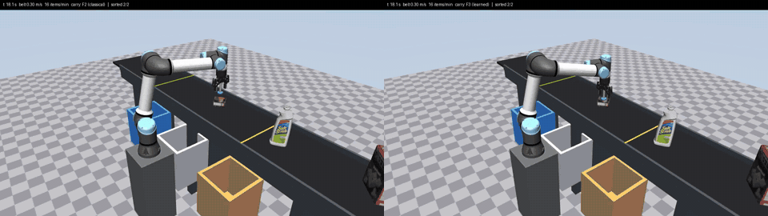</p>
<p align="center"><sub>The same seed, the same 12 s: F2's planned carry (left) and the learned carry (right). Over the full 90 s clip, F2 sorts 10 items with a 5.25 s cycle and the learned line 12 with 3.53 s.</sub></p>

**The honest reading.** Most of the win is the reformulation, not the learning. The hand-written prior alone frees the
robot after 1.07 s instead of 2.63 s, and on held-out items it is about as good as the learned policy (6.98 vs 6.88,
5.55 vs 5.62, 2.92 vs 3.04, 2.24 vs 2.35 per minute); in the held-out stream at 0.15 m/s it even gains more over F2.
What learning added: it fixed the tall cracker box (48% sorted by the prior, 92% by the learned policy, on its 52 recorded grasps: `docs/results/f3/ars-run2.ckpt-0000.json`, `ckpt-0060.json`) and it loses far fewer thrown
items in the mixed stream (70 and 62 dropped over 40 runs, against the prior's 155 and 121), so it sorts more overall.

**What went wrong** (development notes; the run-1 numbers are in `docs/results/f3/ars-run1.metrics.jsonl`).
- **Run 1 over-learned.** With the residual at full authority and a sorted item worth 15 s, training success rose from
  90.8% to 96.7% while held-out success fell from 98.4% to 92.9%, and after iteration 40 the policy traded reliability
  for speed (85% at iteration 120). The held-out Windex bottle, reading swing values it had never seen from such a tall
  item, drove the tool past its chute toward the robot's own base until IK gave out. Run 2: a tighter 8 cm corridor,
  half the residual authority, a sorted item worth 25 s, 10 start states per direction.
- **Two bugs only the line could show**, both found on video: the line declared the robot free before a thrown bottle
  had left the fingers, and an unreachable IK step aborted a carry with the gripper opening mid-air. Training episodes
  ended when the tool stopped, so they could not see either. Lesson: the training episode must end where the
  deployment's next action begins.
- **Attempts 1 and 2 were too small.** Each passed 2 of 4 conditions, a different two each time: that is what noise
  looks like. Attempt 3 was sized from attempt 2's spread before it ran.
- **Two more training runs found nothing.** Retraining with the fixes (40 more iterations) and adding the item's height
  as a 17th feature (60 more) both stayed within the noise of the shipped policy and then traded reliability for speed
  again (89-95.5%): a linear residual cannot express "lower a tall bottle, but only a tall one, only near the chute".

---

## F4 · Seeing, camera only

**The question.** F2 and F3 were handed every item's true pose and name. How much is lost when the cell must see for
itself through a 424x240 depth camera? The bar: vision-only (L4) within 10 percentage points of privileged poses (L2).
Disciplines: perception, state estimation, learning.

<p align="center">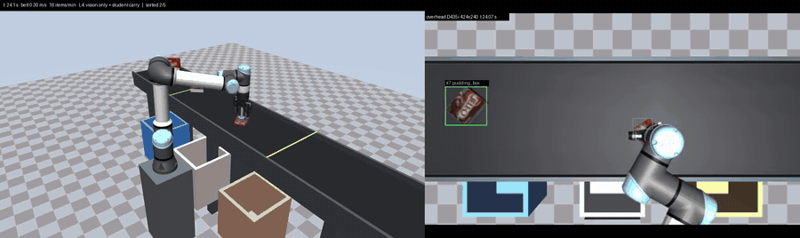</p>
<p align="center"><sub>The vision-only cell at 0.3 m/s: the pick camera (left) and what the overhead camera's perception reports (right), every track boxed and named. 10 s from a 90 s recording.</sub></p>

**The mechanism** (`factory/vision/vision.py`), every 1/30 s of simulated time, with no learned detector:
- render the overhead camera's depth and colour; blank the pixels where it sees the robot (a real cell renders that
  mask from its URDF and joint encoders);
- points more than 8 mm above the belt, grouped into connected blobs; per blob the top face, the minimum-area rectangle
  of the footprint and a 4x4x4 colour histogram;
- **identity** by 3 nearest neighbours among 720 labelled blobs from 240 synthetic scenes; **pose** from a per-class
  model of which rectangle axis is the item's axis and which way it faces;
- blobs join the nearest predicted track, a track reports once 3 frames agree on its name, and the same Kalman
  tracker, scheduler and planner as before take it from there.
- **The student carry**: the F3 policy without the held item's true state (it assumes the item hangs rigidly where the
  grasp put it, so it cannot see the swing). A test wraps the simulator's item-state accessor and fails if the carry
  reads it.

```python
# factory/vision/vision.py: blobs above the belt, the robot masked out; a blob unlike any single item is split at its
# top surfaces (touching pairs, F5) and the split kept only if every part looks like an item
ok = (np.abs(P[..., 1] - b.y) < b.width / 2 - 0.005) & (np.abs(P[..., 0]) < 0.69) & (h > MIN_H) & ~cam.fixture
...
lab, n = ndimage.label(ok)
...
if idm is not None and idm.nn_dist(feat(bl)) > idm.tau:
    parts = split_blob(h, m)
```

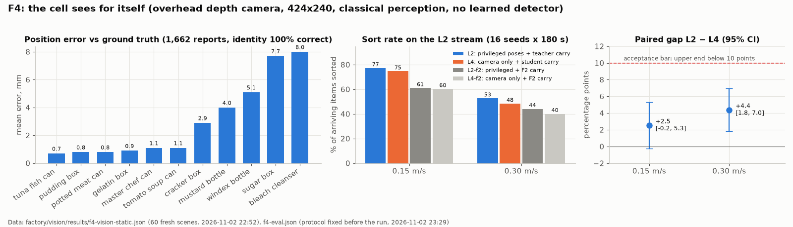
<sub>Data: `factory/vision/results/f4-vision-static.json` (60 fresh scenes, 2026-11-02 22:52), `f4-eval.json` (16 fresh seeds x 180 s, protocol fixed before the run, 2026-11-02 23:29).</sub>

**Measured.** Against the simulator's ground truth: identity correct on **100% of 1,662 reports**, position error
2.4 mm mean (9 mm p95; the tall bottles and the sugar box are worst), 28 ms per frame for render plus perception. On the
line (16 fresh seeds x 180 s): sort rate **74.7% / 48.3%** camera-only against **77.2% / 52.7%** with privileged poses,
paired gap **+2.5 [-0.2, 5.3]** and **+4.4 [1.8, 7.0]** points at 0.15 and 0.3 m/s: **accepted**. Running the old F2
carry on both shows where the gap comes from: at 0.3 m/s it is almost all perception, at 0.15 m/s mostly the student
carry dropping items it cannot feel swinging (35 dropped against 15). The vision-only cell still sorts more than F2's
privileged one (10.1 vs 8.2 and 7.3 vs 6.6 per minute).

**What went wrong** (development notes; the DAgger and student numbers are in `f4-distil.json` and `f4-student-train.json`). The first vision line sorted 2.7 items/min where the privileged one sorted 7.3, and nothing at
0.3 m/s. Comparing every report with the truth found three bugs, none of them in the algorithm: the yellow zone markers
drawn across the belt for people watching were solid to the depth camera and cut every passing item in two; items half
in the picture got the wrong name, and the name stuck (border blobs no longer vote); and the descending gripper hid its
own target and dragged the track with it (blobs touching the robot's silhouette are distrusted). Distillation could not
copy what the student cannot see: three rounds of DAgger did not improve it (93.0-93.3% against 93.5% zero-shot), and
reinforcement learning on the student's own inputs moved it to 94.1% before degrading again.

---

## F5 · The factory: a 10-minute shift

**The question.** Does the whole cell (camera only, student carry, suction for flat boxes, recovery) run continuously,
with clutter, and what would an operations manager see? Disciplines: scheduling, software architecture, safety,
operations.

**The mechanism.** Clutter: a quarter of arrivals come as two items touching side by side; a blob that looks like no
single item is split at its separate top surfaces with a watershed on the height map (both items named in 59 of 60
touching pairs on a stopped belt, 41 without the split, 0 wrong names). The shift runner (`factory/ops/shift.py`)
paces the line to real time and writes a KPI row every simulated second; the lab server's dashboard polls it.

```python
# factory/ops/shift.py: overall equipment effectiveness, the factory-floor KPI
A = 1.0 - self.down_s / max(t, 1e-6); P = handled / max(n, 1); Q = ok / max(handled, 1)
... oee=round(A * P * Q, 3)
```

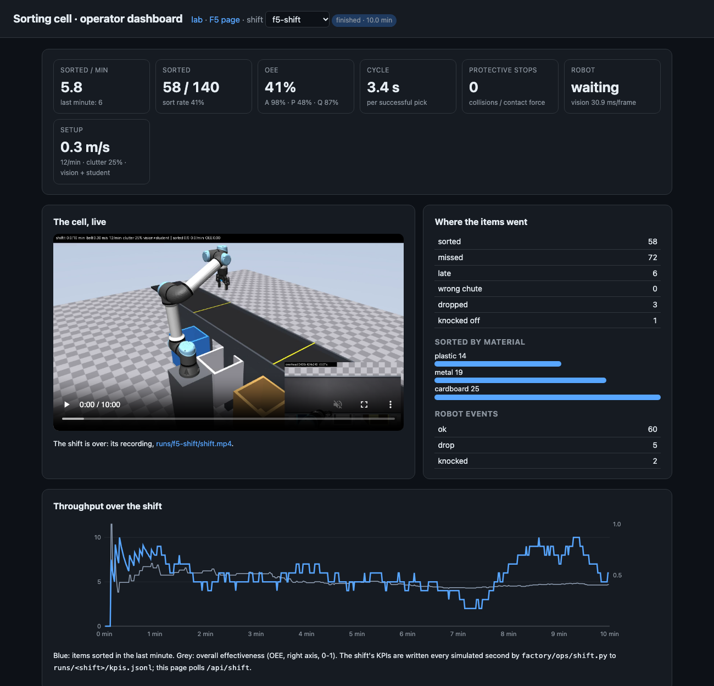
<sub>The dashboard (`lab/static/dashboard.html`, served by `rl lab`) at the end of the recorded shift.</sub>

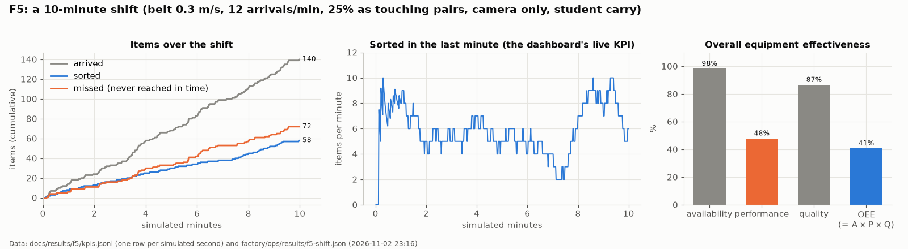
<sub>Data: `docs/results/f5/kpis.jsonl` (600 rows) and `factory/ops/results/f5-shift.json` (2026-11-02 23:16).</sub>

**Measured.** 10 simulated minutes without a stop: 140 items arrived, **58 sorted (5.8/min)**, 0 wrong chutes, 0
protective stops; availability 98%, performance 48%, quality 87%, **OEE 41%**; 3.42 s per successful pick. The main loss
is *missed* (72): the arm was busy only about 38% of the shift on average, but random bursts and touching pairs put
two or three items in the zone within one cycle. Touching pairs fared worst: 8 of their 58 items were sorted. The
next investment is capacity (a second arm, a shorter cycle) or singulation upstream, not better perception.
The one-page report: [`docs/ops/F5-operations-report.md`](docs/ops/F5-operations-report.md).

**What went wrong** (development notes). The first smoke run reported 86% availability with no faults at all: the line flagged its idle
return to the ready pose as "recovering". Downtime now excludes that move.

---

## F6 · A hobby desk arm with a real-device kit

**The question.** Everything so far assumed perfect motors and a perfect camera. Would the pipeline survive the
hardware a hobbyist can actually buy? F6 scales the job down to the SO-101 (a LeRobot desk arm with six Feetech
STS3215 serial-bus servos and a hinged jaw), models every imperfection of a real desk, and builds the routines a real
deployment needs to remove them. Disciplines: layout, kinematics, grasping, control, behaviour cloning, sim-to-real.

<p align="center">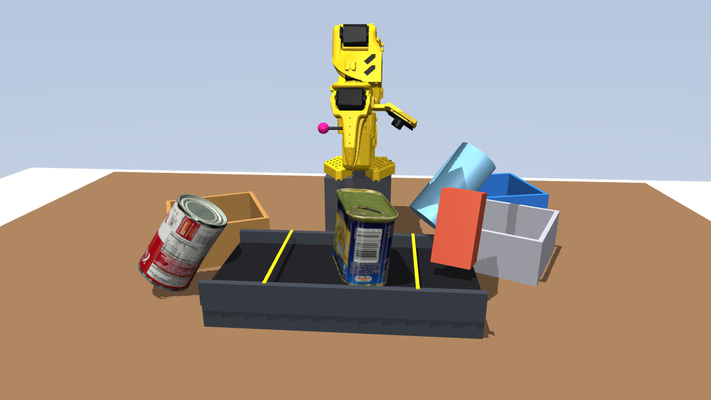 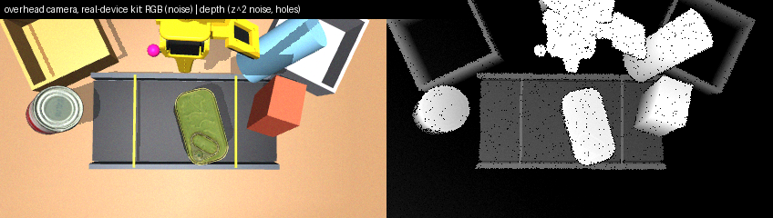</p>
<p align="center"><sub>Left: the desk cell (the magenta ball on the wrist is the calibration marker). Right: what the camera delivers with the kit on: noisy RGB, and depth with z² noise and holes.</sub></p>

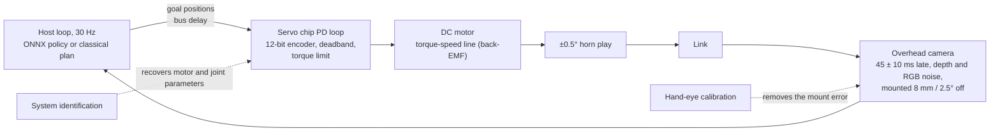

**The mechanism.**
- **The real-device kit** (`factory/desk/servo.py`, `camera.py`): Menagerie's position actuators replaced by a model
  of what is inside a hobby servo (a PD loop on the chip with a 1-count deadband, a 12-bit encoder on the output shaft,
  a DC motor's torque-speed line, ±0.5° of play between shaft and link that the encoder cannot see, a 4 ms bus delay),
  and a camera with depth noise growing with distance squared, holes, RGB noise, latency with jitter, and a mount that
  is not where the drawing says (a planted 8 mm, 2.5° error).
- **Hand-eye calibration**: the arm shows a magenta ball on its wrist to the camera at 96 poses; the camera side fits a
  sphere to the ball's depth pixels, the robot side computes where forward kinematics says the ball is, and the camera
  pose that best maps one onto the other is solved (Kabsch, outlier rejection, then a bundle adjustment with one
  unknown pan-play angle per pose).
- **System identification** (`sysid.py`): a "real arm" with its rotor inertia, damping, friction, bus delay and motor
  speed planted 20-50% off nominal; 72 s per joint of recordings (creeps at a lowered torque limit, steps, coasts with
  the torque switched off, chirps) at 250 Hz; a Gauss-Newton fit that simulates the same goal stream through the same
  servo model and never starts from the planted values.
- **Behaviour cloning** (`bc.py`): 2,661 successful demonstrations of the classical pick (from 3,000 scenes, half with
  injected noise), an MLP (9 → 256 → 256 → 256 → 6) trained on them, exported to **ONNX** and run by onnxruntime in a
  30 Hz loop paced against the wall clock, as LeRobot runs the real SO-101.

```python
# factory/desk/camera.py: the rigid transform that maps the camera's marker sightings onto forward kinematics
def kabsch(A, B):
    """Rigid (R, t) minimizing sum |R a + t - b|^2."""
    ca, cb = A.mean(0), B.mean(0); H = (A - ca).T @ (B - cb); U, S, Vt = np.linalg.svd(H)
    D = np.diag([1, 1, np.sign(np.linalg.det(Vt.T @ U.T))]); R = Vt.T @ D @ U.T; return R, cb - R @ ca
```

<p align="center">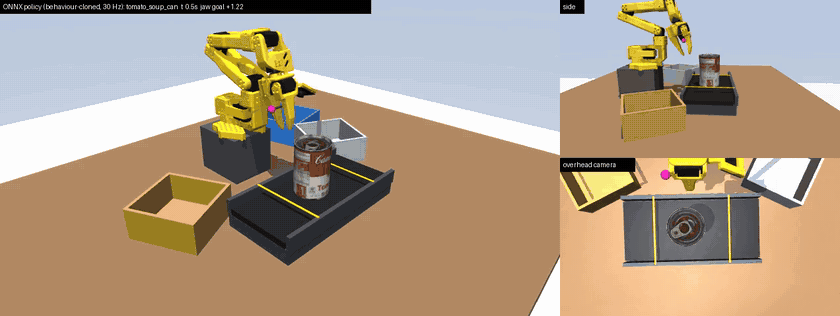</p>
<p align="center"><sub>The behaviour-cloned ONNX policy at 30 Hz with the full kit on: it sees only the camera's estimate of the item, its class and the time. Recorded during development, before the final calibration fix and acceptance attempt 2.</sub></p>

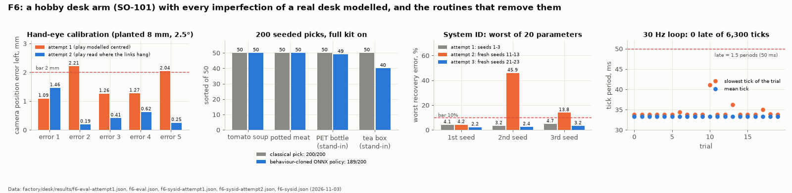
<sub>Data: `factory/desk/results/f6-eval-attempt1.json`, `f6-eval.json`, `f6-sysid-attempt1.json`, `f6-sysid-attempt2.json`, `f6-sysid.json` (2026-11-03).</sub>

**Measured, with the full kit on.** A payload-and-jaw table first: only 2 of the 11 YCB items fit the SO-101's 80 mm
jaw, reach and torque budget (the tomato soup can and the potted meat can, both metal); a PET bottle and a tea box are
named stand-ins for plastic and cardboard, and the rejected items fail physically too (tuna 1/6, pudding 0/6, gelatin
0/6). Then the acceptance:
- **Calibration** (attempt 2, five fresh planted errors): **1.46, 0.19, 0.41, 0.62, 0.25 mm**, at most 0.27° (bar 2 mm,
  1°).
- **Picks** (200 seeded trials, 50 per item): classical **200/200**, ONNX policy **189/200 = 94.5%** (Wilson
  90.4-96.9%; bars 90% and 80%). The tea box is the weak item (40/50, 8 knocked over by the jaw).
- **The 30 Hz loop**: mean tick 33.334 ms, slowest 41.1 ms, **0 late of 6,300 ticks**, inference p99 0.43 ms.
- **System identification** (attempt 3, fresh seeds 21-23): every one of the 20 planted parameters per seed recovered
  within **3.2%** (bar 10%), about 6 minutes per seed on 10 processes.

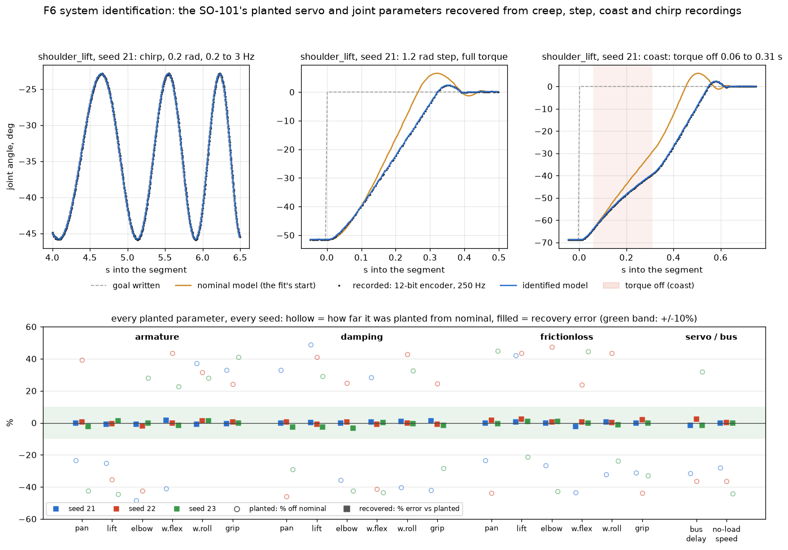
<sub>The project's own figure (`factory/desk/f6_media.py`, from `f6-sysid.json`): hollow markers are how far each parameter was planted from nominal, filled ones how far the fit landed from the planted truth.</sub>

**What went wrong**, which is most of F6's story (development notes; the attempt numbers are in the result files):
- The real servo broke the classical pick that had passed with ideal servos: without its D term the loop chattered ±2°, and with the encoder
  beyond the play the unloaded pan hunted ±0.7°. Encoder on the shaft, play beyond it, D on a 10 ms encoder
  difference: 48/48.
- **The first behaviour-cloned policy copied itself.** It also read the servo positions, fitted the demonstrations to
  0.1°, and failed most closed-loop trials (the details are in `factory/desk/bc.py`'s docstring): it had learned "goal = reading + a small offset", the reading follows the
  goal, and the jaw goal ran away to 6 rad (the copycat problem). With the task observation alone (camera estimate,
  class, time): 40/40.
- **Calibration attempt 1 failed** (2.21 and 2.04 mm on 2 of 5 errors). A systematic 1.5 mm survived two rounds of fit
  tweaks until the error was split with ground truth: the camera side was right to 0.2 mm, the forward-kinematics side
  3 mm off. The wrist's horn play had been modelled as centred because the wrist carries almost no gravity torque with
  the tool pointing down, but the link really sat 0.47° to one end. Reading the gravity torque where the links really
  hang fixed it (`camera.gravity_play`, `test_marker_fk_models_the_play`).
- **System identification passed its development seeds, then failed fresh ones** (bus delay +45.9% on one seed,
  gripper damping +13.8% on another). The fresh seeds had planted fast motors: after a 1.2 rad step the joint still
  swung ±20 counts when the next experiment began, and the cost became a needle with no slope to follow. The fix was in
  the experiment, not the optimiser: longer segments so the swings die out, only informative reads fitted, equal
  weight per kind of experiment.

---

## F7 · The fast belt and the operating envelope

**The question.** The F5 cell was tested at one operating point. Across the conditions a line manager would choose
between (belt speed, load, clutter), where does it break, and can the fast belt (0.5 m/s) be made to work?
Disciplines: control, tracking, scheduling, safety, operations.

**What the envelope found.** At 0.15 m/s the cell sorts 5.8-11.5 items a minute, at 0.3 m/s 4.7-8.2, and **at 0.5 m/s
nothing at all, in every condition: 505 of 505 items missed, without a single attempt**. A 40 s probe logging every
planning decision explained it: 108 pre-grasp IK failures and 0 attempts in 40 s (the F7 operations report). An item crosses the 1.1 m reach
window in 2.2 s, and the v1 approach is so slow that the meeting point it computes is already out of reach.

**The mechanism: three changes, each a flag** (`line.V2_FLAGS`), measured alone and together:

```python
# factory/line/line.py: v2 is v1 with three flags
if "fast" in self.v2: kw.update(vmax=VMAX_FAST, amax=AMAX_FAST, v_desc=0.45, t_lift=0.28)   # joint limits nearer the UR5e's rating
if "early" in self.v2: kw.update(t_lo_min=0.3, decision_s=0.05, scan_step=0.15, n_scan=14, t_close=0.30, t_brake=0.2)
self.min_confirm = 5 if "early" in self.v2 else 10; ready_x = -0.30 if "early" in self.v2 else -0.15   # trust tracks sooner, wait upstream
# "deadline": the scheduler's horizons follow the belt speed instead of a fixed 2 s
```

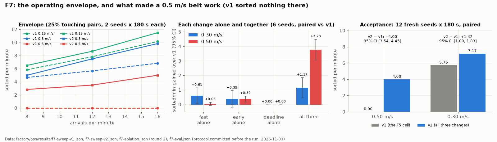
<sub>Data: `factory/ops/results/f7-sweep-v1.json`, `f7-sweep-v2.json`, `f7-ablation.json` (round 2), `f7-eval.json` (2026-11-03).</sub>

**Measured.**
- **Ablation** (6 seeds x 180 s, paired with v1): at 0.5 m/s *fast* alone +0.06, *early* alone +0.39, *deadline* alone
  exactly 0 (identical to v1 run for run), **all three together +3.78 [3.07, 4.49] sorted/min**. Each constraint
  binds as soon as another is relaxed: speed, then the intercept search, then the camera's confirmation distance, then
  the deadline. An ablation of single changes would have discarded all three.
- **Acceptance** (12 fresh seeds x 180 s, protocol committed first): at 0.5 m/s v1 sorted **0.00**/min (550 of 550
  missed) and v2 **4.00**, a paired difference of **+4.00 [3.54, 4.45]**; at 0.3 m/s 5.75 → **7.17**, **+1.42 [1.00,
  1.83]**, better as well as not worse. v2 put 0 items in a wrong chute and showed no new class of protective stop:
  **accepted**. Full tables: [`docs/ops/F7-operations-report.md`](docs/ops/F7-operations-report.md).
- The v2 envelope at 0.5 m/s: 2.8-5.7 sorted/min in every condition; 0 wrong chutes in all 36 runs.

**What went wrong, and what is still wrong** (development notes). With vision on, the camera became the next limit: it first sees an item
at x = -0.44 m and confirmed its track (10 frames) at -0.29 m, while at 0.5 m/s a pick had to be decided before
-0.17 m, a 12 cm slot. *early* now confirms after 5 frames and waits further upstream. The fast belt works, but one arm
sorts only about a quarter of its items (26% in the acceptance): every item is in reach for 2.2 s. Whether *deadline*
adds anything on top of the other two was not measured separately. And there is no video of v1 and v2 side by side at
0.5 m/s yet; it needs a render that has not been made.

---

## All results

Every number with the file it comes from. Dates are when the result was recorded.

| what | result | file | date |
|---|---|---|---|
| Go1 training, 1,024 envs x 600 iterations | 112.1 s (learner on MPS), 139.2 s (CPU); walking at 1 m/s from iteration 225 | `docs/results/locomotion/` | 2026-11-01 |
| Go1 evaluation | 0 falls; speed error 0.11 m/s at 1 m/s, 0.29 at 1.5, 0.37 at -0.6 | `go1-clean.eval.json` | 2026-11-01 |
| mjbatch (MuJoCo 3.14) vs mujoco.batch (3.17), 64 envs x 3 iterations | identical rewards (-4.8511); 1.9 s vs 1.1 s | `docs/results/locomotion/dryrun-*.metrics.jsonl` | 2026-11-01 |
| Go2 training on Metal, 4,096 envs x 101 iterations | 93.5 s incl. compile; eval 0 falls, 0.07 m/s error at the trained 0.5 m/s | `go2-base.*` | 2026-11-01 |
| Throughput | MuJoCo 12.1k → 174k env-steps/s (1 → 18 threads); Genesis Metal 455k at 4,096 envs; PPO update 737/s on MPS | `docs/results/bench/` | 2026-11-01 |
| F0 belt test | MuJoCo 132/132, Genesis (CPU backend) 132/132 | `factory/cell/results/belt-test-*.json` | 2026-11-02 |
| F0 reach | zone 98% (grasp 10 cm up), 83% (25 cm); chutes 100% | `reach-map.json` | 2026-11-02 |
| F1 L0 picks | 198/200 (96.4-99.7%); 199/200 on a second seed; cycle 7.3 s | `factory/classical/results/f1-eval*.json` | 2026-11-02 |
| F1 planning sweep | 996 of 1,000 planned, 0 collisions | `f1-plan-sweep.json` | 2026-11-02 |
| F2 line | 7.8 / 6.5 sorted/min at 0.15 / 0.3 m/s (16 arriving) | `factory/line/results/f2-eval.json` | 2026-11-02 |
| F2 tracking | 7-10 mm at 0.15-0.3 m/s time-stamped; 24-42 mm at 0.3 m/s as fresh | `f2-tracking.json` | 2026-11-02 |
| F3 carry on recorded grasps | 97.5% / 98.4% (training / held-out); free after 0.91 s (F2 2.63 s) | `factory/learned/results/f3-train.json` | 2026-11-02 |
| F3 acceptance | held-out gain over F2 > 0 in 4 of 4 conditions (40 seeds) | `f3-eval.json` (attempt 2: `f3-eval-attempt2.json`) | 2026-11-02 |
| F4 perception | identity 100% of 1,662; 2.4 mm mean position error | `factory/vision/results/f4-vision-static.json` | 2026-11-02 |
| F4 acceptance | L2 − L4 gap +2.5 and +4.4 points (bar 10) | `f4-eval.json` | 2026-11-02 |
| F5 clutter perception | both items named in 59/60 touching pairs | `f5-clutter-perception.json` | 2026-11-02 |
| F5 shift | 58/140 sorted, OEE 41%, 0 wrong chutes, 0 stops | `factory/ops/results/f5-shift.json` | 2026-11-02 |
| F6 calibration | ≤ 1.46 mm, ≤ 0.27° (attempt 2); attempt 1 failed at 2.21 mm | `factory/desk/results/f6-eval*.json` | 2026-11-03 |
| F6 picks with the kit | classical 200/200; ONNX 189/200 | `f6-eval.json` | 2026-11-03 |
| F6 30 Hz loop | 0 late of 6,300 ticks; inference p99 0.43 ms | `f6-eval.json` | 2026-11-03 |
| F6 system ID | within 3.2% (attempt 3); attempt 2 failed 2 of 3 seeds | `f6-sysid*.json` | 2026-11-03 |
| F7 v1 envelope | 0 sorted/min at 0.5 m/s in every condition | `factory/ops/results/f7-sweep-v1.json` | 2026-11-03 |
| F7 acceptance | 0.5 m/s: 0.00 → 4.00 (+4.00 [3.54, 4.45]); 0.3 m/s: 5.75 → 7.17 | `f7-eval.json` | 2026-11-03 |

## What's next

The specification for each is in [`docs/sorting-cell-spec.md`](docs/sorting-cell-spec.md) §4; none is started.

- **F8 · A second arm.** A second UR5e on the same belt, a scheduler that splits items between the arms (start from the
  greedy split, then beat it), a shared-workspace guard tested with planted near-misses, per-arm KPIs. Bar: two arms
  sort at least 1.5x one arm on the same seeds, and a 10-minute shift with 0 arm-arm collisions.
- **F9 · A grasp learned at speed, with a coding agent designing the reward.** Aimed at the failure classes of the fast
  belt, with an Eureka-style loop: 4-8 reward candidates per round written as code, fixed training budgets, per-term
  statistics and contact sheets fed back, only strict improvements over a measured noise floor kept; the success
  predicate, evaluation seeds and simulator hash-checked and off-limits to the agent.
- **F10 · The v2 shift.** Everything on at once for 30 minutes with UR5e real-device parameters, a bit-for-bit replay
  test of a recorded line run, and a scorecard of all fifteen disciplines' acceptance tests.
- Open threads: the student carry's 3.5 / 6.3-point gap to the teacher (a pendulum model of the swing is the idea);
  a humanoid (Unitree G1) on the locomotion side; the real SO-101 on a real desk.

## Tech stack

| layer | used here |
|---|---|
| Physics | MuJoCo 3.17 (`mujoco.batch` for RL, single-model for the cell), Genesis 1.4.5 (Metal and CPU backends) |
| Robot models | MuJoCo Menagerie: UR5e, Robotiq 2F-85, RealSense D435i, SO-101, Unitree Go1; Genesis's Go2 |
| Learning | PyTorch 2.15 (PPO, CPU actor + MPS learner), rsl_rl 5.5.2, Augmented Random Search (NumPy), DAgger, behaviour cloning → ONNX, onnxruntime |
| Geometry and assets | trimesh, CoACD convex decomposition, the YCB Object and Model Set |
| Estimation and planning | NumPy/SciPy: damped least-squares IK, Kalman filters, quintic and minimum-jerk timing, Kabsch, Gauss-Newton (`scipy.optimize.least_squares`) |
| Perception | depth blobs, scipy.ndimage, k-nearest-neighbour identity; no learned detector |
| Ops and tooling | a zsh CLI (`bin/rl`), a standard-library Python web server for the lab and dashboard (MJPEG live views), pytest, matplotlib, ffmpeg, uv |

## Hardware and requirements

- **Measured on:** MacBook Pro, Apple M5 Max (18 CPU cores: 12 performance + 6 efficiency, 40-core GPU), 128 GB
  unified memory, macOS 27. Nothing here needs an NVIDIA GPU. The sorting cell's physics, planning and learning run on the
  CPU and its camera images are rendered with OpenGL; the Go2 trainer and some benchmarks use the Metal GPU.
- Python 3.12 with [uv](https://github.com/astral-sh/uv); zsh; ffmpeg; git. Disk: about 6.5 GB for the two Python
  environments (`envs/mj` 3.7 GB, `envs/genesis` 2.8 GB), 2.3 GB for the Menagerie clone, 270 MB for the YCB scans.
- Memory: the multi-process evaluations use up to ~6 GB per worker; `bin/memguard` caps every heavy job (64 GB by default).
- Smaller Apple Silicon Macs should run everything more slowly; this has not been measured.

## Running it

```sh
./setup.sh                      # builds envs/mj (MuJoCo, Menagerie, PyTorch, ...) and envs/genesis (Genesis, rsl_rl), pinned
scripts/fetch_vendor.sh         # clones MuJoCo Menagerie and mjbatch into vendor/ at the commits used here
bin/rl cell build               # downloads the 11 YCB scans, decomposes them, writes the cell MJCF

# locomotion
bin/rl train go1 --name go1-demo            # CPU, about 2 minutes; writes runs/go1-demo/
bin/rl render go1 runs/go1-demo             # eval.mp4, eval.json, eval-sheet.png
bin/rl train go2 --backend metal            # Genesis on the Apple GPU
bin/rl timeline go1 runs/go1-demo           # every checkpoint side by side

# the sorting cell
bin/rl lab                      # the lab in the browser: a page per phase, run buttons, live views, the dashboard
bin/rl cell live                # an interactive real-time window of the cell
bin/rl pick eval                # F1: 200 seeded picks
bin/rl line live                # F2: watch the line run in the browser
bin/rl carry train              # F3: ARS training on 14 processes
bin/rl line live --perception vision --carry student   # F4: the camera-only cell
bin/rl shift run                # F5: a shift with the dashboard
bin/rl desk live                # F6: the SO-101 desk cell, classical and ONNX picks alternating
bin/rl shift f7 eval            # F7: the fast-belt acceptance
bin/rl factory-test             # the regression suite (pytest)
bin/rl help                     # every command
```

`envs/mjbatch` (only for `rl train go1-mjbatch` and `rl play`) is built with `./setup.sh --with-mjbatch`.
Every run writes `runs/<name>/` (config, `metrics.jsonl`, checkpoints, video, contact sheet); with `RL_COMMIT=1`,
`rl train` first commits the working tree so the run maps to a commit (off by default). GPU jobs go through an optional
GPU-sharing gate when a `hold` command is on PATH ([local-rig](https://github.com/mthomas100/local-rig)); without it they
run directly. The charts in this README are regenerated from the result
files with `uv run --with matplotlib python docs/charts/make_charts.py`. MuJoCo MPC is not used by any result here; `scripts/fetch_vendor.sh --with-mpc` clones it, and building it on macOS 27 /
Xcode 26 needed `-DCMAKE_POLICY_VERSION_MINIMUM=3.5`, gRPC off, `-msse4.1` removed from `build.ninja`, and
`-Wno-deprecated-builtins -Wno-error=deprecated-builtins` (not scripted).

The project was built with Claude Code as the engineer, working through the same `bin/rl` CLI and the files it writes;
that is why every command prints a one-line status and every run leaves machine-readable results.

## Repository layout

| path | what |
|---|---|
| `bin/rl` | the CLI: training, rendering, benchmarks, and every phase of the cell |
| `bin/memguard`, `bin/rl-sheet` | a memory cap for heavy jobs; contact sheets of videos |
| `lib/go1_batch317.py`, `lib/go1_joystick.py` | engine one: the Go1 PPO trainer on `mujoco.batch` and on the archived mjbatch package |
| `lib/go1_timeline.py`, `go1_live.py`, `go1_play.py` | the learning timeline, the live browser grid, an arrow-key drive window |
| `lib/genesis_go2/` | engine two: the Go2 trainer on Genesis and a headless recorder |
| `factory/cell/` | F0: layout, YCB processing, the MJCF builder, MuJoCo and Genesis runtimes, belt/chute/reach tests, live views |
| `factory/classical/` | F1: kinematics, grasp library, planner, executor, evaluation |
| `factory/line/` | F2: tracking, the intercept planner and the line, schedulers, the F7 flags |
| `factory/learned/` | F3/F4: the carry policy, ARS training, start-state snapshots, distillation |
| `factory/vision/` | F4/F5: perception from the depth camera, clutter splitting, the acceptance evaluation |
| `factory/ops/` | F5/F7: the shift runner, the envelope sweep, the fast-belt ablation and acceptance, operations reports |
| `factory/desk/` | F6: the SO-101 cell, servo and camera kit, calibration, system identification, behaviour cloning to ONNX |
| `factory/tests/` | the regression suite; `factory/*/results/` the result files and acceptance protocols |
| `lab/` | the lab web app (`rl lab`): a page per phase with a teaching blurb, a pipeline diagram, media, numbers and run buttons; the dashboard |
| `docs/sorting-cell-spec.md` | the design and every phase's acceptance test |
| `docs/ops/` | the generated operations reports (F5, F7) |
| `docs/results/`, `docs/charts/` | copies of the run data the charts read, and the chart script |
| `scripts/` | setup helpers (YCB and upstream fetches), smoke tests, benchmarks, contact sheets |

## Credits and licences

This repository's own code is MIT licensed ([LICENSE](LICENSE)); five files derived from Apache-2.0 examples stay under
Apache-2.0 ([NOTICE](NOTICE)). Built on:

- **[MuJoCo](https://github.com/google-deepmind/mujoco)** (Apache-2.0) and **[MuJoCo Menagerie](https://github.com/google-deepmind/mujoco_menagerie)** models, each under its own licence: Universal Robots UR5e
  (BSD-3-Clause, ROS-Industrial), Robotiq 2F-85 (BSD-2-Clause, ROS-Industrial), Intel RealSense D435i (Apache-2.0),
  SO-101 (Apache-2.0), Unitree Go1 and Go2 (BSD-3-Clause, Unitree Robotics). The models are fetched into `vendor/` or
  installed from PyPI (`mujoco-menagerie`), not redistributed here.
- **mjbatch** ([kevinzakka/mjbatch](https://github.com/kevinzakka/mjbatch), Apache-2.0): `lib/go1_joystick.py` and `lib/go1_batch317.py` are modified copies of its
  `examples/go1_joystick.py`, which remain under Apache-2.0 ([LICENSES/Apache-2.0.txt](LICENSES/Apache-2.0.txt)); each
  file's header says what changed. Its `examples/assets/theme.xml` is read from `vendor/`.
- **[Genesis](https://github.com/Genesis-Embodied-AI/Genesis)** (Apache-2.0): `lib/genesis_go2/` holds modified copies of its `examples/locomotion` Go2 scripts (headers
  say what changed), with **[rsl_rl](https://github.com/leggedrobotics/rsl_rl)** (BSD-3-Clause) as the PPO implementation.
- **The YCB Object and Model Set** ([CC BY 4.0](https://creativecommons.org/licenses/by/4.0/)): "Yale-CMU-Berkeley (YCB) Object and Model Set was accessed on
  2026-11-02 from https://registry.opendata.aws/ycb-benchmarks." Papers (Calli et al.): "The YCB Object and Model Set: Towards Common
  Benchmarks for Manipulation Research", ICAR 2015 (doi:10.1109/ICAR.2015.7251504), and "Benchmarking in Manipulation
  Research: Using the Yale-CMU-Berkeley Object and Model Set", IEEE Robotics & Automation Magazine 22(3), 2015
  (doi:10.1109/MRA.2015.2448951). The scans are downloaded by `scripts/fetch_ycb.sh`, not redistributed; their
  processing is described in `factory/cell/ASSETS.md`. Product packaging visible on the scans belongs to its owners.
- **[CoACD](https://github.com/SarahWeiii/CoACD)** (MIT), **[trimesh](https://github.com/mikedh/trimesh)** (MIT), **PyTorch** (BSD-3-Clause), **onnxruntime** (MIT), **NumPy/SciPy** (BSD),
  **matplotlib** (PSF-style). Methods from the literature are cited where they are used in the code (Augmented Random
  Search, residual policy learning, DAgger).
- All images and animations in `docs/media/` are renders of this project's own simulations or charts of its own data.
