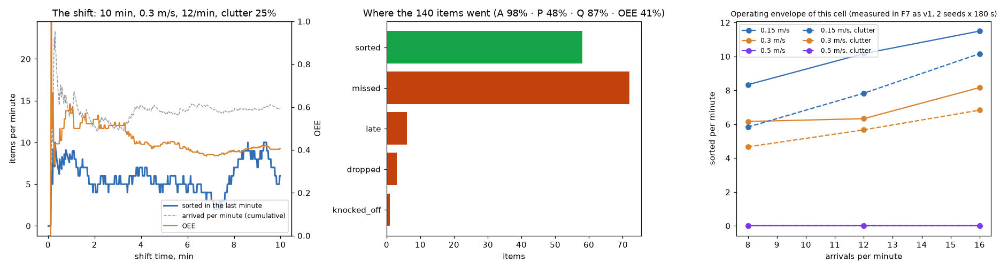

# Operations report: sorting cell v5 (F5), 2026-11-02

Generated by `factory/ops/report.py` from recorded runs (simulation, not a real cell). One page: what the cell is, what one
shift did, where it loses items, and the trade-offs between speed, load and reliability.

## The cell

UR5e + Robotiq 2F-85 with a suction cup for flat boxes (hybrid tool), a 0.4 m belt, three chutes (plastic, metal,
cardboard), one overhead Intel RealSense D435i. Perception: depth blobs, kNN identity, Kalman tracks (F4); the robot
never reads the simulator's poses. Grasp, intercept and lift: classical (F1, F2). Carry: the learned policy in its
vision-only student form (F3, F4). Safety: protective stops on contact or tracking error, recovery and retry (F2).

## The shift (10 minutes of continuous running, 2026-11-02 23:16)

Belt 0.3 m/s, 12 arrivals per minute at random, 25% of them as two touching items, perception: vision, carry: student.

| KPI | value | definition |
|---|---|---|
| throughput | **5.8 sorted/min** (348/h) | items in the right chute per minute |
| sort rate | 41% (58 of 140) | sorted / items that arrived and left |
| availability | 98% | share of the shift not stopped or recovering |
| performance | 48% | items handled (picked at least once) / arrived: what capacity let through |
| quality | 87% | sorted / handled |
| **OEE** | **41%** | availability x performance x quality |
| cycle | 3.42 s | per successful pick (decide, intercept, grasp, lift, carry, release) |
| protective stops | 0 | contact with a fixture or a joint far behind its reference |

Losses: missed 72, late 6, wrong chute 0, dropped 3, knocked off 1. Robot events: ok 60, drop 5, knocked 2.
Items that arrived in touching pairs: sorted 8, missed 43, knocked_off 1, late 5, dropped 1.

## What limits it

- The largest loss is **missed** (72 of 140). With a 3.42 s cycle one arm could sort up to ~18 items/min, and on average it was busy only 38% of the shift: items are missed in bursts, when random arrivals and touching pairs put two or three items in the zone within one cycle. Availability and quality are high; performance is the gap.

## The cell's versions (L2: 16 random arrivals/min, all 11 items; sorted per minute, mean over seeds)

| version | 0.15 m/s | 0.30 m/s | source |
|---|---|---|---|
| F2 classical, privileged poses | 8.034 | 6.534 | F3 attempt 2, F2 arm (attempt 3: 8.47 / 6.73) |
| F3 learned carry, privileged poses | 10.667 | 8.233 | F3 attempt 2 (10 seeds; now `factory/learned/results/f3-eval-attempt2.json`; attempt 3 with 40 seeds: 10.82 / 8.15) |
| F4 vision only, F2 carry | 8.082 | 6.043 | `factory/vision/results/f4-eval.json` |
| F4 vision only, student carry (this cell) | 10.146 | 7.25 | same |

## Trade-offs

- **Belt speed vs reliability.** A faster belt brings items through the reach zone sooner, so each one is reachable for less time: at the same arrival rate more pass unpicked (performance falls) while what is picked still lands (quality stays). The fast belt (0.5 m/s) is where the intercept and the tracking budget get tight (F2's tracking study: 14-26 mm prediction error at 0.5 m/s against 7-10 mm at 0.3).
- **Load vs throughput.** Throughput rises with arrivals until the arm saturates near one item per cycle, then the extra items are simply missed. Running the belt at the saturation load maximises sorted/min; running below it maximises sort rate. Which one matters is a business decision (value of a sorted item vs cost of a missed one).
- **Clutter.** Touching pairs cost twice: perception has to split them (both items named in 59 of 60 touching pairs on a stopped belt, 41 without the split), and two items arriving together compete for one arm. A singulating conveyor upstream, or a second arm, buys back most of it.
- **Learning vs engineering.** The learned carry bought most of the throughput gain over F2 (shorter cycle by releasing in flight); vision cost little on top, because the classical perception is accurate on separated items (2.4 mm, 100% identity in simulation). Real cameras add noise, glare and motion blur that the simulation does not have: the sim-to-real gap (discipline 14) is the next risk, not the algorithm.
- **What to buy next.** Capacity is the binding constraint: a second arm (F5 optional) or a shorter cycle (a faster carry, a better scheduler) converts misses into sorted items; quality and availability are already near their ceilings.

Sources: `factory/ops/results/f5-shift.json`, `runs/f5-shift/kpis.jsonl` (copied to `docs/results/f5/kpis.jsonl`), `factory/learned/results/f3-eval.json`, `factory/vision/results/f4-eval.json`.
