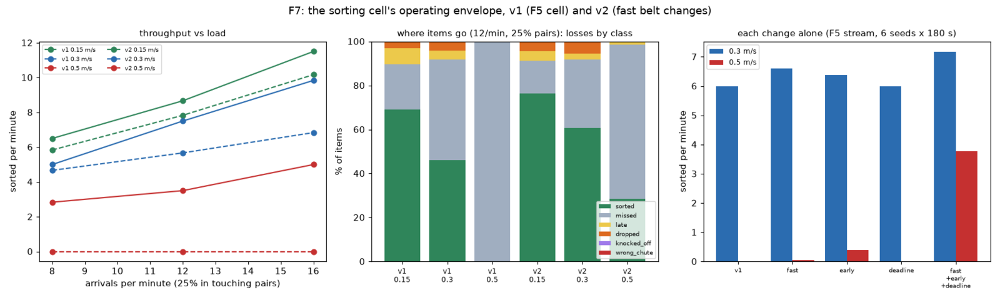

# Operations report: the fast belt (F7), 2026-11-03

Generated by `factory/ops/f7_report.py` from recorded runs (simulation). The v1 cell is the F5 cell (vision only, the student
carry, the hybrid gripper, the lookahead scheduler); v2 adds the F7 changes (`line.V2_FLAGS`: fast, early, deadline).

## The v1 envelope (2 seeds x 180 s per row, seeds from 7000)

| belt m/s | arrivals/min | pairs | sorted/min | sort rate | missed | late | dropped | knocked_off | wrong_chute | protective stops |
|---|---|---|---|---|---|---|---|---|---|---|
| 0.15 | 8 | 0% | 8.335 | 0.808 | 10 | 0 | 1 | 0 | 1 | 0 |
| 0.15 | 8 | 25% | 5.835 | 0.691 | 8 | 5 | 3 | 0 | 0 | 0 |
| 0.15 | 12 | 0% | 10.17 | 0.762 | 16 | 0 | 3 | 0 | 0 | 0 |
| 0.15 | 12 | 25% | 7.83 | 0.696 | 14 | 5 | 2 | 0 | 0 | 0 |
| 0.15 | 16 | 0% | 11.5 | 0.726 | 22 | 1 | 3 | 0 | 0 | 0 |
| 0.15 | 16 | 25% | 10.165 | 0.677 | 23 | 4 | 2 | 0 | 0 | 1 |
| 0.3 | 8 | 0% | 6.165 | 0.544 | 29 | 1 | 1 | 0 | 0 | 0 |
| 0.3 | 8 | 25% | 4.665 | 0.538 | 21 | 1 | 1 | 0 | 0 | 0 |
| 0.3 | 12 | 0% | 6.33 | 0.441 | 40 | 3 | 5 | 0 | 0 | 0 |
| 0.3 | 12 | 25% | 5.67 | 0.457 | 34 | 3 | 3 | 0 | 0 | 0 |
| 0.3 | 16 | 0% | 8.165 | 0.463 | 49 | 4 | 4 | 0 | 0 | 1 |
| 0.3 | 16 | 25% | 6.835 | 0.391 | 57 | 4 | 2 | 0 | 0 | 2 |
| 0.5 | 8 | 0% | 0.0 | 0.0 | 71 | 0 | 0 | 0 | 0 | 0 |
| 0.5 | 8 | 25% | 0.0 | 0.0 | 52 | 0 | 0 | 0 | 0 | 0 |
| 0.5 | 12 | 0% | 0.0 | 0.0 | 87 | 0 | 0 | 0 | 0 | 0 |
| 0.5 | 12 | 25% | 0.0 | 0.0 | 74 | 0 | 0 | 0 | 0 | 0 |
| 0.5 | 16 | 0% | 0.0 | 0.0 | 112 | 0 | 0 | 0 | 0 | 0 |
| 0.5 | 16 | 25% | 0.0 | 0.0 | 109 | 0 | 0 | 0 | 0 | 0 |

At 0.5 m/s the v1 cell sorts nothing: every item is missed. Its approach (joint limits 2.4 / 3.0 rad/s, the intercept searched from 0.6 s after the decision in 0.35 s steps) is too slow for an item that crosses the 1.1 m reach window in 2.2 s: the planner's pre-grasp pose is already out of reach when the tool could get there (in a probe, 108 pre-grasp IK failures and 0 attempts in 40 s).

## The v2 envelope (2 seeds x 180 s per row, seeds from 7000)

| belt m/s | arrivals/min | pairs | sorted/min | sort rate | missed | late | dropped | knocked_off | wrong_chute | protective stops |
|---|---|---|---|---|---|---|---|---|---|---|
| 0.15 | 8 | 0% | 8.17 | 0.802 | 7 | 0 | 5 | 0 | 0 | 0 |
| 0.15 | 8 | 25% | 6.5 | 0.764 | 6 | 1 | 5 | 0 | 0 | 0 |
| 0.15 | 12 | 0% | 11.0 | 0.815 | 6 | 4 | 5 | 0 | 0 | 1 |
| 0.15 | 12 | 25% | 8.665 | 0.76 | 10 | 3 | 3 | 0 | 0 | 2 |
| 0.15 | 16 | 0% | 13.0 | 0.814 | 11 | 0 | 7 | 0 | 0 | 0 |
| 0.15 | 16 | 25% | 11.5 | 0.772 | 12 | 4 | 5 | 0 | 0 | 1 |
| 0.3 | 8 | 0% | 7.5 | 0.661 | 18 | 0 | 5 | 0 | 0 | 0 |
| 0.3 | 8 | 25% | 5.0 | 0.579 | 15 | 0 | 6 | 0 | 0 | 0 |
| 0.3 | 12 | 0% | 8.67 | 0.604 | 27 | 1 | 6 | 0 | 0 | 0 |
| 0.3 | 12 | 25% | 7.5 | 0.599 | 23 | 2 | 4 | 0 | 0 | 0 |
| 0.3 | 16 | 0% | 8.67 | 0.492 | 39 | 1 | 14 | 0 | 0 | 0 |
| 0.3 | 16 | 25% | 9.835 | 0.563 | 38 | 4 | 3 | 1 | 0 | 1 |
| 0.5 | 8 | 0% | 4.835 | 0.406 | 42 | 0 | 0 | 0 | 0 | 0 |
| 0.5 | 8 | 25% | 2.835 | 0.321 | 31 | 3 | 1 | 0 | 0 | 0 |
| 0.5 | 12 | 0% | 5.33 | 0.362 | 54 | 1 | 1 | 0 | 0 | 0 |
| 0.5 | 12 | 25% | 3.5 | 0.287 | 52 | 1 | 0 | 0 | 0 | 0 |
| 0.5 | 16 | 0% | 5.665 | 0.303 | 75 | 3 | 0 | 0 | 0 | 0 |
| 0.5 | 16 | 25% | 5.0 | 0.272 | 74 | 5 | 0 | 0 | 0 | 0 |

## Each change on its own (F5 stream: 12 arrivals/min, 25% touching pairs)

| speed · variant | sorted/min | sort rate | attempt success | cycle s | protective stops | wrong chutes |
|---|---|---|---|---|---|---|
| 0.30 m/s · v1 | 6.0 | 0.453 | 0.912 | 3.522 | 2 | 0 |
| 0.30 m/s · fast | 6.61 | 0.504 | 0.906 | 3.152 | 0 | 0 |
| 0.30 m/s · early | 6.387 | 0.484 | 0.925 | 3.428 | 0 | 0 |
| 0.30 m/s · deadline | 6.0 | 0.453 | 0.912 | 3.522 | 2 | 0 |
| 0.30 m/s · fast+early+deadline | 7.167 | 0.541 | 0.927 | 3.005 | 0 | 0 |
| 0.50 m/s · v1 | 0.0 | 0.0 | 0.0 | None | 0 | 0 |
| 0.50 m/s · fast | 0.055 | 0.003 | 0.083 | 2.78 | 0 | 0 |
| 0.50 m/s · early | 0.388 | 0.025 | 0.833 | 2.588 | 0 | 0 |
| 0.50 m/s · deadline | 0.0 | 0.0 | 0.0 | None | 0 | 0 |
| 0.50 m/s · fast+early+deadline | 3.778 | 0.271 | 0.858 | 2.662 | 0 | 0 |

Paired differences against v1 on the same seeds (sorted/min, mean [95% CI]):

- fast: 0.30 m/s +0.61 [+0.07, +1.16]; 0.50 m/s +0.06 [-0.05, +0.16]
- early: 0.30 m/s +0.39 [-0.18, +0.96]; 0.50 m/s +0.39 [+0.19, +0.59]
- deadline: 0.30 m/s +0.00 [+0.00, +0.00]; 0.50 m/s +0.00 [+0.00, +0.00]
- fast+early+deadline: 0.30 m/s +1.17 [+0.48, +1.85]; 0.50 m/s +3.78 [+3.07, +4.49]

## Acceptance (pre-registered, `factory/ops/results/f7-eval-protocol.md`)

Rule: 0.5 m/s: 95% CI of (v2 - v1) sorted/min above 0; 0.3 m/s: its lower bound above -margin; 0 wrong chutes and no new protective-stop class for v2 (margin 0.5 sorted/min). Seeds 8000-8011, 180 s each.

- 0.50 m/s: v2 - v1 = +4.00 sorted/min [+3.54, +4.45] (n = 12)
- 0.30 m/s: v2 - v1 = +1.42 sorted/min [+1.00, +1.83] (n = 12)

Verdict: {"fast_beats_v1": true, "not_worse_at_0_3": true, "wrong_chutes_v2": 0, "new_stop_classes": [], "accepted": true}

